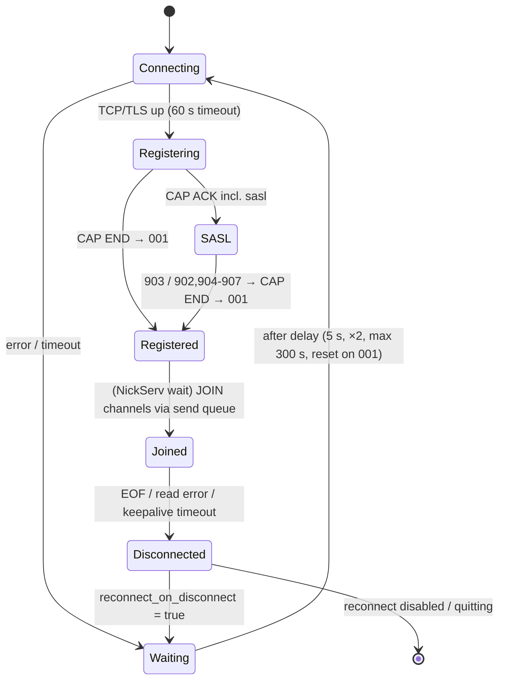

[Docs home](../index.md) › Architecture › Connection lifecycle

# Connection lifecycle

This page follows one IRC connection from start to finish: connecting, capability negotiation, authentication, registration, joining channels, staying connected, and reconnecting.

> **Note:** This page describes `ibot/bot.py` as of commit `565ddbd`, which added the connection hardening described here (see the [changelog](../changelog.md#2026-10-23)). A bot process started before that commit runs the older behaviour until you restart it.

## In this article

- [Prerequisites](#prerequisites)
- [Lifecycle at a glance](#lifecycle-at-a-glance)
- [Connecting](#connecting)
- [Registration and CAP](#registration-and-cap)
- [ISUPPORT](#isupport)
- [After registration (001)](#after-registration-001)
- [Nick collisions](#nick-collisions)
- [Keepalive](#keepalive)
- [Disconnects](#disconnects)
- [Reconnects](#reconnects)
- [Shutting down and restarting](#shutting-down-and-restarting)
- [State tracked per connection](#state-tracked-per-connection)
- [Timing constants](#timing-constants)
- [Known limitations](#known-limitations)
- [See also](#see-also)

## Prerequisites

- [Architecture overview](overview.md)
- [Authentication](../configuration/authentication.md) for the SASL/NickServ settings

## Lifecycle at a glance



## Connecting

Before each connection attempt ibot resets all per-connection state (see [State tracked per connection](#state-tracked-per-connection)), then connects.

| Setting | Effect |
|---|---|
| `host`, `port` | `asyncio.open_connection(host, port)`, wrapped in a **60-second** timeout (`CONNECT_TIMEOUT`) |
| `use_ssl = true` | TLS using `ssl.create_default_context()`, with the system CA store and hostname checking |
| `verify_ssl = false` | Turns off certificate **and** hostname verification. Use it only for testing. |
| `bind_host` | When set, passed as `local_addr=(bind_host, 0)` so the connection leaves from that local address. Logged as `Binding outgoing connection to …` |

The log shows `Connecting to irc.example.net:6697 (SSL=True)...` and then `Connected to irc.example.net:6697`.

## Registration and CAP

Right after connecting, ibot sends three lines straight to the socket (they don't go through the flood queue):

```text
CAP LS 302
NICK MyBot
USER <user or nick> 0 * :<name or "MyBot - ibot">
```

`user` and `name` come from the `[core]` keys of the same names. When they're unset, the ident is the nick and the realname is `<nick> - ibot`.

ibot wants these capabilities: `account-tag`, `extended-join`, `multi-prefix`, `server-time`, plus `sasl` when `auth_method = sasl`. It only requests the ones the server advertises.

| Server reply | ibot's action |
|---|---|
| `CAP * LS * :…` (multi-line, 302) | Buffers the advertised capability names until the final line |
| `CAP * LS :…` (final line) | Logs `Server capabilities: …`. Sends one `CAP REQ` for the intersection of wanted and advertised caps; if the intersection is empty, sends `CAP END`. If SASL is configured but `sasl` isn't advertised, logs a WARNING and continues **without** SASL. |
| `CAP * ACK :…` | Records the enabled caps (a `-cap` entry removes one). If `sasl` was ACKed and SASL is wanted, sends `AUTHENTICATE PLAIN` once. |
| `CAP * NAK :a b c` | Logs `CAP NAK: …`. If the rejected request held more than one cap, ibot re-requests **each cap individually** (once per connection), so one unsupported cap doesn't cost all of them. A NAK of `sasl` is logged at ERROR, and registration continues without SASL. |
| `CAP * DEL :…` | Removes the caps from the enabled and available sets |
| `CAP * NEW :…` | Logged only; nothing is requested |
| `AUTHENTICATE +` | Sends base64 of `user\0user\0password`, where `user` is `auth_user` or the nick. With no password, it sends `AUTHENTICATE *` (abort). |
| `903` | Logs `SASL authentication successful` |
| `902`/`904`/`905`/`906` | Logs `SASL authentication failed (<code>): …` at ERROR. Registration **continues without** authentication. |
| `907` | Logs `SASL: already authenticated` |
| `ERROR` | Logged at WARNING (`Server ERROR: …`) |
| `001` | Marks the connection registered and runs the post-registration steps |

`CAP END` is sent exactly once, when every outstanding `CAP REQ` has been answered **and** SASL (if started) has finished.

## ISUPPORT

ibot parses `005 RPL_ISUPPORT` into `bot.isupport` (a dict of token → value; `-TOKEN` removes one). Three tokens are used internally:

| Token | Used for | Default before 005 arrives |
|---|---|---|
| `PREFIX` | Mapping mode letters and NAMES symbols to privileges | `(qaohv)~&@%+` |
| `CHANMODES` | Knowing which channel modes take a parameter when parsing `MODE` | `beI,k,l,` |
| `NICKLEN` | Truncating fallback nicks | 30, then 9 after 6 failed attempts |

## After registration (001)

1. **Bookkeeping**: the reconnect delay is reset to 5 s, the nick-attempt counter to 0. If the nick in the `001` differs from the one ibot sent, ibot adopts the server's version. Nick-based patterns are refreshed.
2. **NickServ**: if `auth_method = nickserv` and a password is set, ibot sends `PRIVMSG <auth_target or NickServ> :IDENTIFY <password>` and waits **5 seconds**.
3. **Nick regain**: if the bot isn't on its configured nick, it starts the regain task described in [Nick collisions](#nick-collisions).
4. **Channel list**: the union of `[core] channels` and the database list saved by `.bjoin` (`plugin_values`: `admin` / `persistent_channels`).
5. **Join**: one `JOIN <entry>` per channel, in sorted order, put on the **flood-controlled send queue**. An entry such as `#chan key` sends `JOIN #chan key`.

> **Note:** The 5-second NickServ wait happens **inside the read loop**, so no server lines are processed during it. That's harmless during registration, but it does delay everything else by 5 seconds.

Join failures:

| Numeric | Meaning | Action |
|---|---|---|
| `471` | Channel full | Warn, then retry `JOIN <channel>` (without the key) through the send queue. Delays: 10 s, 20 s, 40 s … capped at 300 s, at most **8** retries per channel per connection, then `Giving up on joining …` |
| `477` | Need a registered nick (+R) | Same as 471 |
| `473` | Invite-only | Warning only |
| `474` | Banned | Warning only |
| `475` | Bad key | Warning only |

A pending retry is cancelled (and its counter reset) when the bot joins that channel, parts it, or is kicked from it.

## Nick collisions

**During registration** (before `001`), the numerics `432` (erroneous), `433` (in use), `436` (collision) and `437` (unavailable) make ibot pick another nick, always derived from the **configured** nick:

| Attempt | Nick tried |
|---|---|
| 1 | `MyBot_` (for `432`: the configured nick with invalid characters removed, if that differs) |
| 2 | `MyBot__` |
| 3+ | `MyBot_NNN` (random 100–999) |

Every candidate is truncated to the server's `NICKLEN` (or 30, then 9 after 6 attempts when `NICKLEN` is unknown). After **20** failed attempts ibot drops the connection and goes through the normal reconnect delay.

**After registration**, a nick error (for example a `433` reply to `.bnick TakenNick`) is only logged: `Nick change to TakenNick refused (433: …); keeping MyBot`.

**Regaining the nick**: if registration ended on a fallback nick and a NickServ password is configured (`auth_method` = `nickserv` or `sasl`), ibot:

1. sends `PRIVMSG <target> :GHOST <configured nick> <password>` (`target` is `auth_target` for `nickserv`, `NickServ` for `sasl`),
2. waits 3 s and sends `NICK <configured nick>`,
3. with `auth_method = nickserv` only, waits another 3 s and, if the nick change worked, sends `IDENTIFY` again.

Without a password it just logs that it isn't attempting to regain the nick.

> **Note:** `GHOST` is an Anope/Atheme command. On services that don't support it, the regain attempt fails harmlessly and the bot stays on the fallback nick.

Whenever the bot's own nick changes (a `001` with a different nick, a `NICK` message for the bot), the dispatcher recompiles `$nick`/`$nickname` rules and nickname commands. On every reconnect the nick is reset to the configured one, so a `.bnick` change doesn't survive a reconnect.

## Keepalive

| Mechanism | Behaviour |
|---|---|
| Server `PING` | Answered with `PONG <same params>` immediately, bypassing the queue |
| Read timeout | If nothing arrives for **240 s** (`READ_TIMEOUT`), ibot sends `PING :ibot-<unix time>` |
| Dead link | If nothing arrives within **60 s** (`PING_TIMEOUT`) after that PING, ibot logs `No reply from server 60s after keepalive PING; reconnecting` and ends the connection |

Any received data resets the timer, so a silent-but-dead link is detected within about 5 minutes.

## Disconnects

The connection ends when:

- the server closes it (`Connection closed by server`)
- a read raises an exception (`Error reading from server`, with a traceback)
- the keepalive times out
- no usable nick was found after 20 attempts
- `.bquit`/`.die`, a plugin's `bot.quit()`/`bot.restart()`, or `SIGINT`/`SIGTERM` stop the bot

ibot then cancels the send loop, every interval job, pending JOIN retries and helper tasks (such as nick regain), and closes the socket (waiting at most 5 s).

Reading is robust against bad input: bytes are decoded with an **incremental** UTF-8 decoder (a multi-byte character split across reads decodes correctly; invalid bytes become U+FFFD), lines end at `\n` with an optional `\r`, more than 64 KiB of unterminated input is discarded, and an exception while handling one line is logged without dropping the connection.

## Reconnects

| Aspect | Behaviour |
|---|---|
| Enabled by | `reconnect_on_disconnect = true` (the default) |
| First delay | 5 seconds (`Reconnecting in 5 seconds...`) |
| Growth | Doubles after every attempt, up to `MAX_RECONNECT_DELAY` = 300 s |
| Reset | Back to 5 s whenever a connection reaches `001` |
| Connection errors | Exceptions while connecting are logged (`Connection error`) and go through the same delay |
| What's reset | Tracked channels and users, CAP/SASL state, ISUPPORT data, nick (back to the configured one), pending joins, **the send queue** (lines queued for the old connection are dropped), flood tokens |
| What's re-run | Connect, CAP/NICK/USER, NickServ, joins, and interval jobs |
| What's kept | `bot.memory`, plugin state and the database connection |

With `reconnect_on_disconnect = false`, the first disconnect ends `bot.run()`, and the process exits after running plugin `shutdown()` functions.

## Shutting down and restarting

| Trigger | Sequence |
|---|---|
| `.bquit [msg]` / `.die`, or `bot.quit(msg)` in a plugin | Marks the bot as stopping, writes `QUIT :msg` directly to the socket, waits up to 3 s for the server to close the link, then closes it. No reconnect. |
| `bot.restart(msg)` in a plugin | Same as quit (default message `Restarting`), then the process re-executes itself as `python -m ibot <same arguments>` from the original working directory |
| `SIGINT` / `SIGTERM` | `QUIT :Shutdown signal` is written straight to the socket, which is then closed |
| Then | The database is closed, `Bot shut down.` is logged, `__main__` calls `shutdown(bot)` for each **currently loaded** plugin, and the handler thread pool is told to stop |

> **Note:** No built-in admin command calls `restart()`. It exists for plugins (Sopel has the same method).

## State tracked per connection

| State | Source |
|---|---|
| `bot.channels` | JOIN/PART/KICK/QUIT and `353` (NAMES). When the bot leaves a channel, users it no longer shares a channel with are forgotten. |
| Channel privileges | `353` prefixes and `MODE` changes, interpreted with ISUPPORT `PREFIX`/`CHANMODES` |
| `bot.users` | JOIN, NAMES, NICK, QUIT |
| User accounts | `extended-join`, `ACCOUNT` messages, and `account` message tags |
| Topic | `332` and `TOPIC` |
| `bot.nick` | `001` registration, NICK changes, the nick-collision fallback |
| `bot.isupport` | `005` |

All of these are cleared before each new connection.

## Timing constants

These are module constants in `ibot/bot.py`, not configuration keys.

| Constant | Value | Meaning |
|---|---|---|
| `CONNECT_TIMEOUT` | 60 s | TCP/TLS connect timeout |
| `READ_TIMEOUT` | 240 s | Silence before a keepalive PING |
| `PING_TIMEOUT` | 60 s | Silence after that PING before reconnecting |
| `INITIAL_RECONNECT_DELAY` | 5 s | Reconnect delay after a successful session |
| `MAX_RECONNECT_DELAY` | 300 s | Reconnect delay cap |
| `MAX_NICK_ATTEMPTS` | 20 | Fallback nicks tried before reconnecting |
| `NICK_REGAIN_DELAY` | 3 s | Wait between GHOST and NICK |
| `JOIN_RETRY_BASE_DELAY` / `JOIN_RETRY_MAX_DELAY` / `JOIN_RETRY_MAX_ATTEMPTS` | 10 s / 300 s / 8 | 471/477 join retries |
| `QUIT_TIMEOUT` | 3 s | Wait for the server to close after QUIT |
| `MAX_LINE_BYTES` | 510 | Longest line written to the socket |

## Known limitations

- The NickServ `IDENTIFY` wait blocks line processing for 5 s.
- Nick regain relies on the services `GHOST` command.
- A nick set with `.bnick` is lost at the next reconnect.
- SASL supports `PLAIN` only, and a payload over 400 bytes isn't split.

## See also

- [Flood control](flood-control.md)
- [Authentication](../configuration/authentication.md)
- [Per-channel settings](../configuration/per-channel.md)
- [Troubleshooting](../troubleshooting.md)

---
[← Back to docs home](../index.md)
