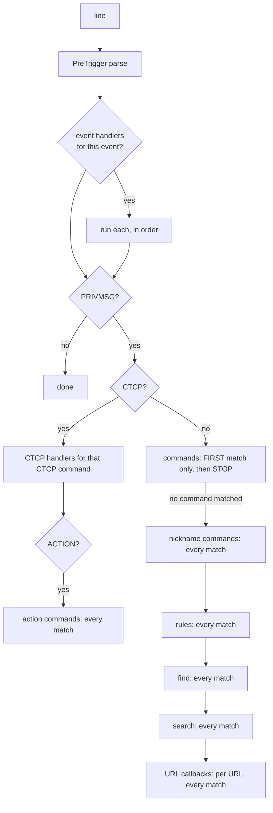

[Docs home](../index.md) › Architecture › Dispatch

# Dispatch

This page explains how ibot turns an incoming IRC line into plugin calls: how patterns are compiled, the order handlers are tried in, the filters each call passes through, the threading model, and rate limiting.

## In this article

- [Prerequisites](#prerequisites)
- [Pattern compilation](#pattern-compilation)
- [Handler ordering](#handler-ordering)
- [Dispatch order for a line](#dispatch-order-for-a-line)
- [The filter chain](#the-filter-chain)
- [Trigger fields](#trigger-fields)
- [Threading model](#threading-model)
- [Rate limiting](#rate-limiting)
- [Known limitations](#known-limitations)
- [See also](#see-also)

## Prerequisites

- [Architecture overview](overview.md)
- Familiarity with Python regular expressions

## Pattern compilation

Patterns are compiled when a plugin is registered (at startup, `.load`, `.reload` and `.rehash`). Patterns that depend on the bot's nick are recompiled automatically whenever the bot's own nick changes.

| Handler type | Decorator | Compiled pattern | Flags | Matched with |
|---|---|---|---|---|
| Command | `@plugin.command('cmd')` | `^` + *prefix* + `(cmd)(?:\s+(.*))?$` | `IGNORECASE` | `match` on the text |
| Nickname command | `@plugin.nickname_command('cmd')` | `^` + *nick* + `[:,\s]\s*(cmd)(?:\s+(.*))?$` | `IGNORECASE` | `match` |
| Action command | `@plugin.action_command('cmd')` | `^(cmd)(?:\s+(.*))?$` | `IGNORECASE` | `match` on the `/me` text |
| Rule | `@plugin.rule(r'…')` | Your pattern, with `$nickname` → *nick* and `$nick` → *nick*`[:,\s]\s*` | `IGNORECASE` (+ `VERBOSE` if the pattern contains a newline) | `match` |
| Find | `@plugin.find(r'…')` | Your pattern | `IGNORECASE` (+ `VERBOSE` if multi-line) | `finditer`: one call per match |
| Search | `@plugin.search(r'…')` | Your pattern | `IGNORECASE` (+ `VERBOSE` if multi-line) | `search`: first match only |
| URL | `@plugin.url(r'…')` | Your pattern | `IGNORECASE` (+ `VERBOSE` if multi-line) | `search` against each URL found in the message |
| Event | `@plugin.event('JOIN')` | Event name, upper-cased | — | Exact event name |
| CTCP | `@plugin.ctcp('VERSION')` | CTCP command, upper-cased | — | Exact CTCP command |
| Lazy variants | `@plugin.rule_lazy`, `url_lazy`, `find_lazy`, `search_lazy` | The loader is called **once at registration** with the settings | — | as above |

Notes:

- *prefix* is `[core] prefix` inserted **as a regular expression**. `\.` matches a literal dot, and glitchy's `\$` matches a literal dollar sign. An unescaped `.` would match any character.
- *nick* is `re.escape(bot.nick)`. Rules containing `$nick`/`$nickname` and all nickname commands are recompiled when the bot's nick changes (on `001` with a different nick, or a `NICK` for the bot).
- The command name is `re.escape`d, so commands are literal strings.
- Already-compiled `re.Pattern` objects passed to rule, find, search or URL decorators are used as they are, flags included.
- String rule, find, search and URL patterns are case-insensitive, as in Sopel. Use `(?-i:…)` for a case-sensitive part.
- A string pattern containing a newline is compiled with `re.VERBOSE`, so whitespace and `#` comments in it are ignored (Sopel does the same).
- `$nickname` is substituted **before** `$nick`, so both placeholders work as in Sopel.
- Rules attached to CTCP handlers are compiled with the same flags.

## Handler ordering

Inside each handler list, entries are sorted by:

1. `@plugin.priority`: `high` → `medium` (the default) → `low`
2. Plugin name (alphabetical)
3. Function name (alphabetical)

## Dispatch order for a line



1. **Event handlers** for the line's event (`PRIVMSG`, `JOIN`, `001`, …) run first, whatever the content.
2. For a `PRIVMSG` with a CTCP payload (`\x01VERSION\x01`, `\x01ACTION waves\x01`):
   - CTCP handlers for that CTCP command run. If the handler also has `@plugin.rule` patterns, those are matched against the CTCP text and the handler runs only when one matches.
   - For `ACTION`, action commands are tried as well.
   - Commands, rules and URLs are **not** tried for CTCP messages.
3. For a normal `PRIVMSG`:
   - **Commands**: the first command pattern that matches is dispatched, and **dispatch ends there**. No nickname commands, rules, find, search or URL handlers run for that line.
   - Otherwise nickname commands, rules, find, search and URL handlers are all tried, and **every** match runs.

`NOTICE` lines only reach event handlers (`@plugin.event('NOTICE')`).

## The filter chain

Every candidate handler call passes through these checks, in this order. The first one that fails drops the call silently, unless noted otherwise.

| # | Check | Skipped when | Configuration |
|---|---|---|---|
| 1 | **Echo**: the sender is the bot itself | The function has `@plugin.echo` | — |
| 2 | **Ignore list**: the nick is in `nick_blocks`, or the hostmask matches `host_blocks` | `@plugin.unblockable` | [Core reference](../configuration/core-reference.md#nick_blocks) |
| 3 | **Bots**: the message has a `bot` tag, or the user is already marked as a bot | `@plugin.allow_bots` | — |
| 4 | **Disabled in this channel**: the plugin is listed in the channel's `[#channel] disable_plugins` config (or `*` is), or was disabled with `.disable` | The plugin is `admin` | [Per-channel settings](../configuration/per-channel.md) |
| 5 | **Account lookup**: not a filter. Fills in `trigger.account` from the tag or from tracked state. | — | — |
| 6 | **Predicates**: `require_*` decorators, run in the order they were applied (**bottom-up**) | — | May reply with the decorator's message |
| 7 | **Rate limit** | Admins, unless `include_admins=True` | May send the rate message as a `NOTICE` |
| 8 | **Run**: on the handler thread pool, or inline with `@plugin.thread(False)` | — | — |

Predicate order example:

```python
@plugin.require_admin('Admins only.')      # applied 3rd → checked 2nd
@plugin.require_privmsg('Use this in PM.') # applied 2nd → checked 1st
@plugin.command('secret')                  # applied 1st
def secret(bot, trigger): ...
```

A non-admin typing `.secret` in a channel sees `Use this in PM.`.

## Trigger fields

| Attribute | Meaning |
|---|---|
| `trigger` (itself a `str`) | The message text: the last IRC argument |
| `trigger.nick` | The sender's nick, as an `Identifier` |
| `trigger.user`, `trigger.host`, `trigger.hostmask` | The sender's ident, host, and full `nick!user@host` |
| `trigger.sender` | The channel, **or** the sender's nick in a private message |
| `trigger.is_privmsg` | `True` when the message isn't in a channel |
| `trigger.event` | The IRC command or numeric |
| `trigger.args` | The IRC arguments, with the text last |
| `trigger.tags` | IRCv3 message tags (unescaped) |
| `trigger.time` | `server-time` if present, otherwise the time it was received (UTC) |
| `trigger.account` | The services account, or `None` |
| `trigger.admin`, `trigger.owner` | Permission flags. See [Permissions](../administration/permissions.md). |
| `trigger.group(n)`, `trigger.groups()`, `trigger.match` | Regex results. For commands, `group(1)` is the command name and `group(2)` the arguments. |
| `trigger.ctcp`, `trigger.urls`, `trigger.plain` | The CTCP command, the URLs found, and the text without formatting codes |

See the [Plugin API reference](../developer-guide/plugin-api-reference.md#trigger) for the full list.

## Threading model

| Aspect | Behaviour |
|---|---|
| Matching and filters | Run on the **event loop thread**, synchronously, for every line |
| Handler body | Submitted to a bounded **handler pool** of daemon worker threads (the default) |
| `@plugin.thread(False)` | Runs **inline on the event loop**. Anything slow here stalls all network I/O, PONGs included. |
| Interval jobs | `loop.run_in_executor(None, …)`, the default `ThreadPoolExecutor` |
| Exceptions | Logged as `Unhandled exception in plugin '<p>', function '<f>', triggered by <nick> in <sender>`. Nothing is sent to IRC. |
| Output from threads | Thread-safe: lines are put on the send queue through `run_coroutine_threadsafe` |
| Thread limit | `[core] handler_threads` workers (default **64**), started lazily as needed |
| Queue limit | `[core] handler_queue_size` waiting calls (default **10000**). When the queue is full, the call is **dropped** and `Handler queue full (N workers busy); dropped N job(s) so far` is logged (at most every 30 s). |

Worker threads are daemon threads and the pool's shutdown doesn't wait for them, so a handler that's halfway through its work when the bot stops won't finish it. A handler that never returns permanently occupies one worker.

> **Note:** `handler_threads` and `handler_queue_size` are read once, when the dispatcher is created at startup. Change them with a restart.

## Rate limiting

| Decorator | Scope |
|---|---|
| `@plugin.rate(user=, channel=, server=, message=, include_admins=)` | All three scopes, in seconds |
| `@plugin.rate_user(s)`, `rate_channel(s)`, `rate_global(s)` | One scope each |

Behaviour:

- The check and the recording of the timestamp happen **together, under a lock, before** the handler runs. If the handler returns `plugin.NOLIMIT`, the recorded timestamp is rolled back (unless a newer call has been recorded meanwhile).
- A blocked call sends the rate `message` (if there is one) to the user as a `NOTICE`, literally. Sopel-style placeholders such as `{time_left}` are **not** filled in.
- Admins and the owner are exempt unless `include_admins=True`. Their calls are still recorded, so they count against the limit for later non-admin calls.
- Timestamps older than an hour are cleaned up every 5 minutes, so limits longer than 3600 s aren't reliable.

## Known limitations

| Limitation | Effect |
|---|---|
| A command match stops dispatch | URL handlers and rules don't see lines that start with a command, so `.say look http://x` produces no URL title |
| First-matching command wins, and checks happen later | If the winning handler is disabled in the channel, fails a predicate, or is rate-limited, the same command from another plugin **doesn't** run either |
| `@plugin.event` combined with `@plugin.rule` | The function is registered in both lists. It runs for **every** line of that event (the rule isn't applied to the event), and also for any PRIVMSG that matches the rule. Sopel applies the rule *to* the event instead. |
| Imported decorated functions register twice | See [Plugin management](../administration/plugin-management.md#what-counts-as-a-plugin) |
| A full handler queue drops calls | Under extreme load some triggers are silently skipped (logged as a warning) |

## See also

- [Writing plugins](../developer-guide/writing-plugins.md)
- [Plugin API reference](../developer-guide/plugin-api-reference.md)
- [Flood control](flood-control.md)

---
[← Back to docs home](../index.md)
