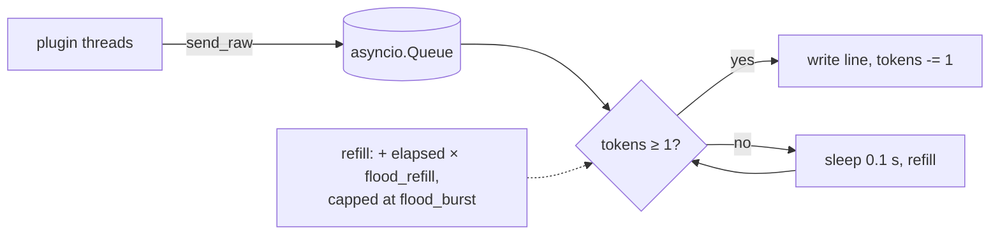

[Docs home](../index.md) › Architecture › Flood control

# Flood control

ibot sends plugin output (and its own channel joins) through a token-bucket queue, so that bursts of messages don't get the bot disconnected for "Excess Flood". This page explains the algorithm, what does and doesn't go through the queue, how lines are sanitised, how long messages are split, and how to tune the settings.

## In this article

- [Prerequisites](#prerequisites)
- [The token bucket](#the-token-bucket)
- [Settings](#settings)
- [What goes through the queue](#what-goes-through-the-queue)
- [Line safety](#line-safety)
- [Message length and splitting](#message-length-and-splitting)
- [Tuning examples](#tuning-examples)
- [Limitations](#limitations)
- [See also](#see-also)

## Prerequisites

- [Architecture overview](overview.md)

## The token bucket



1. The bucket starts **full**, with `flood_burst` tokens.
2. Each line sent costs **1 token**.
3. Tokens come back at `flood_refill` per second, up to `flood_burst`.
4. When the bucket is empty, the send loop checks again every 0.1 s until a token is available.
5. When the queue is idle, the bucket is topped up once a second.

**Example with the defaults** (`flood_burst = 4`, `flood_refill = 1`): a plugin that queues 10 lines at once gets the first 4 out immediately, then about one more per second, so the last line goes out roughly 6 seconds later.

## Settings

| Key | Type | Default | Meaning |
|---|---|---|---|
| [`flood_burst`](../configuration/core-reference.md#flood_burst) | int | `4` | Bucket size: the maximum number of lines sent back to back |
| [`flood_refill`](../configuration/core-reference.md#flood_refill) | int | `1` | Tokens per second: the steady-state lines per second |
| [`flood_empty_wait`](../configuration/core-reference.md#flood_empty_wait) | int | `0` | Accepted but **not used** |

These values are read once, when the bot starts. Neither `.rehash` nor a reconnect changes them.

> **Warning:** Use positive whole numbers. `0` (or an invalid value) falls back to the default, but a **negative** value leaves the bucket permanently empty, and the bot never sends anything through the queue.

## What goes through the queue

| Path | Queued? |
|---|---|
| `bot.say`, `bot.reply`, `bot.notice`, `bot.action`, `bot.msg` | ✅ |
| `bot.write`, `bot.join`, `bot.part`, `bot.kick` | ✅ |
| Admin commands (`.say`, `.raw`, `.bjoin`, `.bmode`, …) | ✅ |
| The automatic `JOIN`s after `001` | ✅ |
| Join retries (471/477) | ✅ |
| `PONG` replies and keepalive `PING`s | ❌ Sent directly |
| Registration: `CAP`, `AUTHENTICATE`, `NICK`, `USER` | ❌ Sent directly |
| NickServ `IDENTIFY`, `GHOST`, and the nick-collision `NICK` retries | ❌ Sent directly |
| `QUIT` from `.bquit`/`bot.quit()`/`bot.restart()` | ❌ Sent directly |
| The quit message on `SIGINT`/`SIGTERM` | ❌ Written directly |

Lines sent directly don't use up tokens. Because the post-registration `JOIN`s are queued, a bot configured with many channels joins them at the bucket's pace (`flood_burst` at once, then `flood_refill` per second).

> **Note:** If a plugin calls a send method before the event loop is running, for example in `setup()` at startup, the line is **silently dropped**. It isn't queued for later.

On every reconnect the queue is **emptied** and the bucket refilled, so lines meant for the old connection are never sent on the new one.

## Line safety

Every line, queued or direct, passes through one final check before it's written to the socket:

| Check | Effect |
|---|---|
| Embedded `\r`, `\n` or `\0` | Replaced with a space, so a single call can never produce a second IRC command |
| Length | Truncated to **510 bytes** of UTF-8 (512 minus CRLF), on a character boundary |
| Terminator | `\r\n` appended |

The wrapper methods also handle line breaks themselves before that, as shown below.

## Message length and splitting

| Method | Splitting |
|---|---|
| `bot.say(text, max_messages=1)` | Splits on `\r\n`, `\r` or `\n`, then into chunks of at most **400 bytes** of UTF-8, never in the middle of a character, and sends up to `max_messages` chunks. The default of **1** means long text is cut off, as in Sopel. Each line of multi-line text counts as a chunk. |
| `bot.reply(text)` | Same as `say`, with `nick: ` in front |
| `bot.msg(target, text)` | Splits on line breaks (empty lines dropped), then into 400-byte chunks, and sends **all** of them |
| `bot.notice(text)` | Splits on line breaks and into 400-byte chunks; sends all of them as separate `NOTICE`s |
| `bot.action(text)` | Splits on line breaks, one `ACTION` per line; no length splitting (the 510-byte socket limit still applies) |
| `bot.write(args, text)`, `bot.kick`, `bot.join`, `bot.part`, `bot.quit` | Line breaks and NUL are collapsed into spaces; no splitting |

Each chunk is a separate line, and each one costs a token.

## Tuning examples

```ini
[core]
# Conservative (large public networks):
flood_burst = 3
flood_refill = 1

# Faster, for a server you control:
# flood_burst = 10
# flood_refill = 3
```

Network-specific limits vary. If the bot gets disconnected with `Excess Flood`, lower `flood_burst` first.

## Limitations

- `flood_refill` can't be set below 1 line per second, because fractional values aren't accepted.
- The bucket isn't weighted by line length: a 400-byte line costs the same as a 5-byte one.
- Lines a plugin sends while the bot is disconnected are dropped when the next connection starts.
- Text longer than 510 bytes sent with `write`/`action` is truncated, not split.

## See also

- [Connection lifecycle](connection-lifecycle.md)
- [Core reference: flood settings](../configuration/core-reference.md#flood_burst)
- [Plugin API reference](../developer-guide/plugin-api-reference.md)

---
[← Back to docs home](../index.md)
