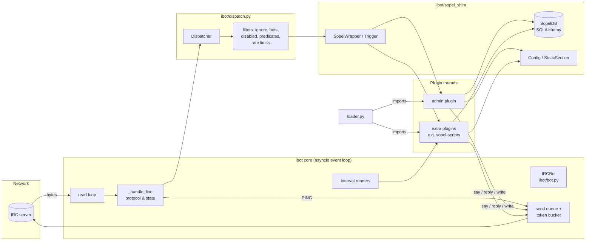

[Docs home](../index.md) › Architecture › Overview

# Architecture overview

This page describes ibot's main components, how they fit together, and how a message flows from the IRC server to a plugin and back. It's meant for operators who want to understand the bot's behaviour, and for contributors working on the core.

## In this article

- [Prerequisites](#prerequisites)
- [Design goals](#design-goals)
- [Component diagram](#component-diagram)
- [Components](#components)
- [Source layout](#source-layout)
- [Startup sequence](#startup-sequence)
- [Message flow](#message-flow)
- [Threads and the event loop](#threads-and-the-event-loop)
- [See also](#see-also)

## Prerequisites

- Basic familiarity with IRC (lines, commands, numerics) and Python `asyncio`.
- Optional: a checkout of the source, to follow along. See [Installation](../getting-started/installation.md).

## Design goals

| Goal | How it's achieved |
|---|---|
| Run unmodified Sopel plugins | A compatibility package (`ibot/sopel_shim`) is installed in `sys.modules` as `sopel`, `sopel.plugin`, `sopel.tools`, `sopel.config`, and so on, **before** plugins are imported |
| Small, readable core | A single asyncio connection class (`IRCBot`), a dispatcher, and a loader |
| Keep the network responsive | Socket I/O runs on one asyncio event loop. Plugin code runs in separate threads. |
| Don't get the bot kicked for flooding | All plugin output goes through a token-bucket send queue |
| Reuse existing Sopel data | The database layer uses Sopel's SQLAlchemy schema |

## Component diagram



## Components

| Component | File | Responsibility |
|---|---|---|
| Entry point | `ibot/__main__.py` | Parses the CLI, loads the config, sets up logging, installs the shim, finds plugin directories, loads plugins, runs `setup()`, starts the event loop, and runs `shutdown()` at exit |
| Config loader | `ibot/config.py`, `ibot/sopel_shim/config/` | Parses the INI file with `configparser`. `CoreSection` exposes typed `[core]` keys, and `StaticSection` supports plugin sections. |
| Connection | `ibot/bot.py` (`IRCBot`) | TCP/TLS connect, CAP/SASL, registration, NickServ, joins, PING/PONG, tracking channel/user/privilege/account state, the send queue, reconnects, interval jobs |
| Dispatcher | `ibot/dispatch.py` | Compiles handler patterns, parses lines into `PreTrigger`, matches them, filters them, rate-limits them, and runs handlers on a bounded thread pool (`HandlerPool`) |
| Loader | `ibot/loader.py` | Installs the `sopel` shim modules, imports plugin files, and collects decorated functions |
| Sopel shim | `ibot/sopel_shim/` | The `plugin` decorators, `Trigger`/`PreTrigger`, `SopelWrapper` (the `bot` object plugins see), `tools`, `formatting`, `db`, `config`, `target` |
| Admin plugin | `ibot/plugins/admin.py` | Runtime management commands. See [Admin commands](../administration/admin-commands.md). |

## Source layout

```text
ibot/
├── __init__.py
├── __main__.py          # CLI entry point (python3 -m ibot)
├── bot.py               # IRCBot: connection, protocol, state, send queue
├── config.py            # load_config(), create_default_config()
├── dispatch.py          # Dispatcher, RateLimiter
├── loader.py            # install_sopel_shim(), load_plugins(), reload
├── plugins/
│   └── admin.py         # built-in admin plugin
└── sopel_shim/          # becomes "sopel" in sys.modules
    ├── __init__.py
    ├── bot.py           # SopelWrapper
    ├── config/
    │   ├── __init__.py  # Config
    │   ├── core_section.py  # CoreSection ([core] keys)
    │   └── types.py     # StaticSection, ValidatedAttribute, ...
    ├── db.py            # SopelDB (SQLAlchemy, Sopel schema)
    ├── formatting.py    # IRC colour/format codes
    ├── module.py        # legacy sopel.module alias
    ├── plugin.py        # decorators
    ├── privileges.py    # VOICE/HALFOP/OP/... constants
    ├── target.py        # User / Channel
    ├── tools/
    │   ├── __init__.py  # Identifier, SopelMemory, events, ...
    │   ├── time.py
    │   └── web.py
    └── trigger.py       # PreTrigger, Trigger
tests/                   # pytest suite (see Testing)
```

## Startup sequence

```mermaid
sequenceDiagram
    participant M as __main__
    participant L as loader
    participant D as Dispatcher
    participant B as IRCBot
    participant S as Server
    M->>M: parse args, load_config(), setup_logging()
    M->>L: install_sopel_shim()
    M->>M: build plugin_dirs (built-in, extra, <cfgdir>/plugins)
    M->>L: load_plugins(dirs, exclude, enable)
    M->>B: IRCBot(settings)  (opens the database)
    M->>D: Dispatcher(bot); register_plugins()
    M->>D: load_disabled_commands()
    M->>L: setup_registered_plugins() (a plugin whose setup() fails is unregistered)
    M->>B: asyncio.run(bot.run())
    B->>S: connect (TLS), CAP LS 302, NICK, USER
    S-->>B: CAP LS (offered caps)
    B->>S: CAP REQ (wanted ∩ offered)
    S-->>B: CAP ACK / NAK, (SASL), CAP END, 001
    B->>S: (NickServ IDENTIFY), queued JOIN for each channel
    M->>L: at exit: run shutdown() for loaded plugins, stop the pool
    M->>M: if a restart was requested: os.execv(python -m ibot …)
```

> **Warning:** `setup()` runs **before** the event loop starts. Messages a plugin tries to send from `setup()` are **silently dropped**, because `send_raw` needs a running loop. Send from an event handler instead, for example `@plugin.event('001')`.

## Message flow

1. The **read loop** reads up to 4096 bytes, decodes them with an incremental UTF-8 decoder (so a character split across reads survives; invalid bytes become U+FFFD), and splits the buffer into lines on `\n`, stripping a trailing `\r`. More than 64 KiB without a line break is discarded. If the server is silent for 240 s it sends a keepalive `PING`, and reconnects if nothing arrives in the next 60 s.
2. `_handle_line` answers `PING` immediately (bypassing the queue) and updates protocol state: CAP, SASL, `001`, `005` (ISUPPORT), nick errors (`432`/`433`/`436`/`437`), JOIN/PART/QUIT/KICK/NICK/MODE/NAMES/TOPIC tracking, join-failure retries. An exception while handling one line is logged and the loop carries on.
3. The line is passed to `Dispatcher.dispatch()`, which builds a `PreTrigger` and finds matching handlers. See [Dispatch](dispatch.md).
4. Each matching handler goes through the filters, predicates and rate limit on the event loop, and is then **submitted to the handler pool**, where a worker thread runs it with a `SopelWrapper` (`bot`) and a `Trigger`.
5. Plugin output (`bot.say`, `reply`, `notice`, `write`, …) goes into the **send queue**, using `asyncio.run_coroutine_threadsafe`.
6. The **send loop** takes one token per line and writes it to the socket. See [Flood control](flood-control.md).

## Threads and the event loop

| Runs on | What |
|---|---|
| Event loop (main thread) | Socket reads and writes, protocol handling, pattern matching, the send queue, timers, and handlers marked `@plugin.thread(False)` |
| Handler pool: up to `handler_threads` daemon workers (default 64), with a queue of `handler_queue_size` (default 10000) | Every other command, rule, and event handler |
| The asyncio default executor | Interval jobs (`@plugin.interval`) |

> **Note:** Filters, predicates and the rate limit run on the event loop *before* a job is queued, so a rate-limited or denied call never occupies a worker. If the pool's queue is full, new calls are dropped and a warning is logged. See [Dispatch: Threading model](dispatch.md#threading-model).

Shared state (`bot.channels`, `bot.users`) is protected by a re-entrant lock inside `IRCBot` while ibot updates it. `bot.memory` is a `SopelMemory`: a dictionary where each individual get or set takes an internal lock. Compound read-modify-write sequences are **not** atomic, so plugins must do their own locking for those.

## See also

- [Connection lifecycle](connection-lifecycle.md)
- [Dispatch](dispatch.md)
- [Flood control](flood-control.md)
- [Database](database.md)
- [Sopel compatibility](../developer-guide/sopel-compatibility.md)

---
[← Back to docs home](../index.md)
